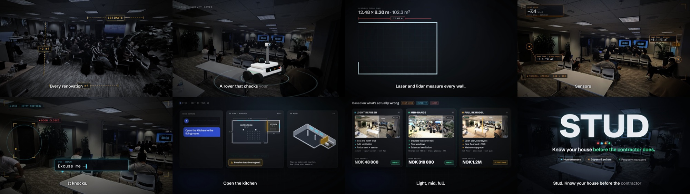

# Stud: pitch video (Physical AI hackathon)

A 40-second pitch video for **Stud**, a concept for a home-inspection rover that measures rooms with laser and lidar, finds heat loss, moisture, CO2 and radon, and turns a spoken request ("open the kitchen to the living room") into renovation options with rough costs. Made at a Physical AI hackathon in San Francisco, 5 October 2026.



## My role

I made the video: script, scene design, 3D and motion graphics, voice-over, music and sound effects, and the final render. The video is generated entirely from code. The rover in the video is a 3D model built in code, and the measurements and costs on screen are illustrative.

## How it works

- **Remotion** renders React components frame by frame into an MP4.
- **React Three Fiber / three.js** draw the 3D rover and a "2.5D" room: two photos of the venue are turned into displaced planes using depth maps, so the camera can move through a still photo.
- **ElevenLabs** generates the narration, music bed and sound effects from scripts in `scripts/`. Word-level timestamps from the voice-over drive the on-screen captions.
- `src/timing.ts` is the single timeline for scenes, voice-over and sound effects.

## Running it

```console
npm i
npm run dev                                   # Remotion Studio preview
npx remotion render Main out/video.mp4        # render the video
npm run lint                                  # eslint + tsc
```

The generated audio is committed, so rendering does not need an API key. To regenerate audio, put `ELEVENLABS_API_KEY` in `.env` and run `npx tsx scripts/generate-voice.mts` (voice) or `npx tsx scripts/generate-music-sfx.mts` (music and SFX).

## Layout

- `src/scenes/`: the eight scenes (Hook, Meet, Measure, Sense, Knock, Talk, Options, Close)
- `src/room/`: depth-parallax room from photo + depth map
- `src/three/`: rover model, stage and glow
- `src/AudioMix.tsx`, `src/Captions.tsx`: narration, music ducking, SFX and word-by-word captions
- `scripts/`: ElevenLabs generation scripts

## Stack

TypeScript, React 19, Remotion 4, React Three Fiber, three.js, ElevenLabs API.
